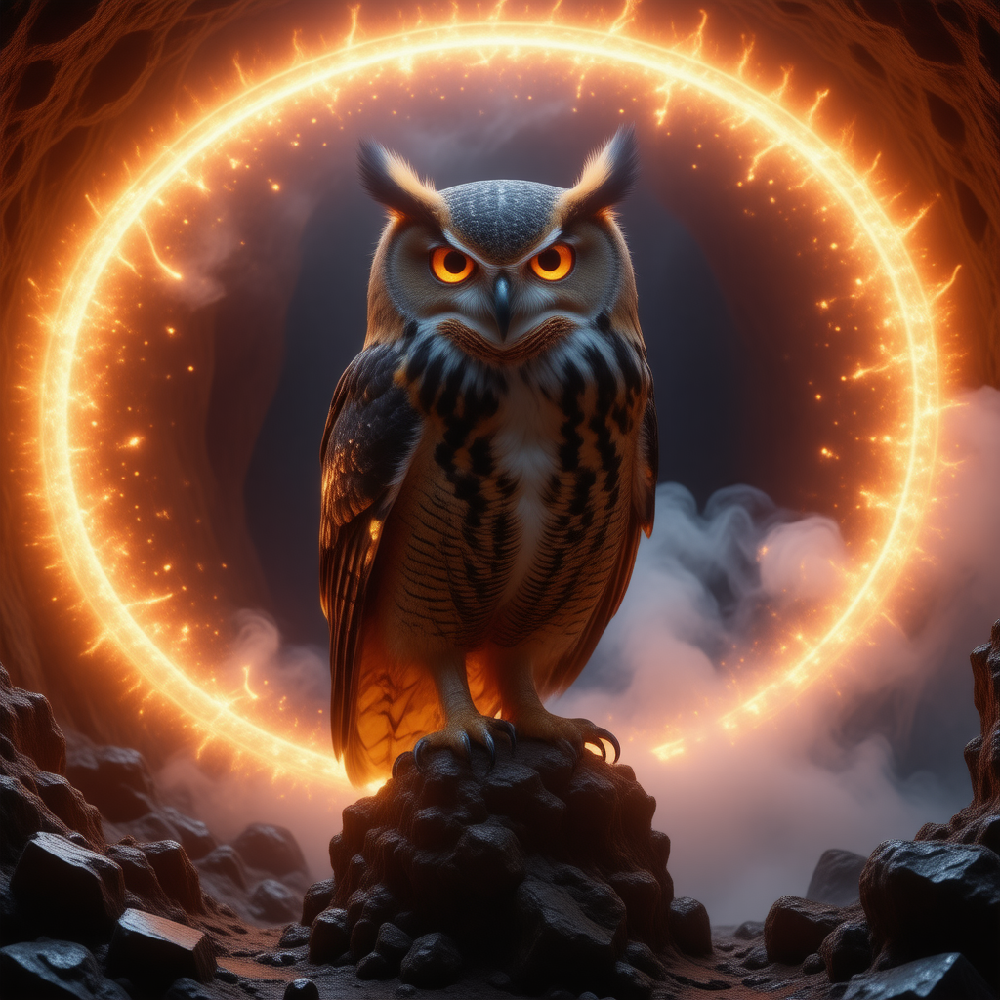

# halodiffuse

---

[](https://www.amd.com/)
[](https://www.amd.com/)
[](https://www.rust-lang.org/)
[](https://www.vulkan.org/)
[](https://www.gnu.org/licenses/agpl-3.0)
[](https://huggingface.co/stabilityai/stable-diffusion-3.5-large-turbo)

---

## Quick Start

```shell
# 1. Download and prepare weights into ~/.local/share/halodiffuse
halodiffuse install
# 2. Loads weights into memory
halodiffuse start
# 3. Generate 1024x1024 PNG images
halodiffuse --prompt "A majestic cybernetic owl perched on an obsidian monolith inside a dark volcanic cavern, a blazing ring of amber and crimson plasma hovering like a halo behind its head, intricate brushed copper feathers and glowing optical glass eyes, volumetric mist, dramatic rim lighting, medium format photography, shallow depth of field" --path ~/Pictures/cat.png -seed 42
# 4. Check weights status or stop to free memory
halodiffuse status
halodiffuse stop
```



---

## Requirements

- **Hardware:** AMD Ryzen AI Max+ 395 Linux
- **Model Access:** Accept the [Stability AI Community License](https://huggingface.co/stabilityai/stable-diffusion-3.5-large-turbo) on Hugging Face

---

## Installation

### 1. Install the binary

```shell
curl -LO https://github.com/Legendofzaday/halodiffuse/releases/latest/download/halodiffuse
chmod +x halodiffuse
sudo mv halodiffuse /usr/local/bin/
```

### 2. Prepare model weights

`stabilityai/stable-diffusion-3.5-large-turbo` is a gated repository, make sure you have accepted its license on [Hugging Face](https://huggingface.co/spaces/stabilityai/stable-diffusion-3.5-large-turbo) and provide a [HF_TOKEN](https://huggingface.co/settings/tokens/new?preset=read-only)

```shell
# Download from Hugging Face and prepare weights automatically
HF_TOKEN=hf_your_token_here halodiffuse install

# Or prepare from an existing local model directory
halodiffuse install --raw-dir /path/to/sd-3.5-large-turbo

# Re-prepare and overwrite existing weight packs
HF_TOKEN=hf_your_token_here halodiffuse install --force

# Note: amdgpu.lockup_timeout is recommended to be increased and for optimal performance run in tty.
```

---

## CLI Reference

```text
Usage:
  halodiffuse install [--force] [--raw-dir <DIR> | <DIR>]
  halodiffuse start
  halodiffuse stop
  halodiffuse status
  halodiffuse --prompt <TEXT> --path <FILE> [--seed <U64>]

Options:
  -p, --prompt <TEXT>  Text prompt
  -o, --path <FILE>    Output PNG path (1024x1024 RGB8)
  -s, --seed <U64>     RNG seed (random if omitted)
  -h, --help           Show help
  -V, --version        Show version
```

---

## Benchmarks

**Configuration:** Stable Diffusion 3.5 Large Turbo | `FP16` | `1024x1024` | `Batch Size 1`

> All engines were benchmarked with models **pre-loaded and warm in memory** to measure true per-image generation time.

| Engine                    | Backend      | Precision   | End-to-End (Warm) | Runtime                   |
| :------------------------ | :----------- | :---------- | :---------------- | :------------------------ |
| **`halodiffuse`**         | **`Vulkan`** | **`FP16`**  | **`4.8s`**       | **`~23.7 MB binary`**     |
| **ComfyUI**               | ROCm         | BF16 / FP16 | ~11.8 – 14.5 s    | ~18 GB Python + ROCm venv |
| **stable-diffusion.cpp**  | Vulkan       | FP16        | ~13.5 – 16.2 s    | ~50 MB binary             |
| **HuggingFace Diffusers** | ROCm         | BF16 / FP16 | ~18.4 s+          | ~18 GB Python + ROCm venv |

---

## Code License

halodiffuse  
Copyright (C) 2026 Thopuri Omkar Eeswar

This program is free software: you can redistribute it and/or modify
it under the terms of the GNU Affero General Public License as published by
the Free Software Foundation, version 3 of the License.

This program is distributed in the hope that it will be useful,
but WITHOUT ANY WARRANTY; without even the implied warranty of
MERCHANTABILITY or FITNESS FOR A PARTICULAR PURPOSE. See the
GNU Affero General Public License for more details.

You should have received a copy of the GNU Affero General Public License
along with this program. If not, see https://www.gnu.org/licenses/.

## Model License

The Stable Diffusion 3.5 Large Turbo model weights are governed by the [Stability AI Community License Agreement](https://huggingface.co/stabilityai/stable-diffusion-3.5-large-turbo/blob/main/LICENSE.md). `Powered by Stability AI`