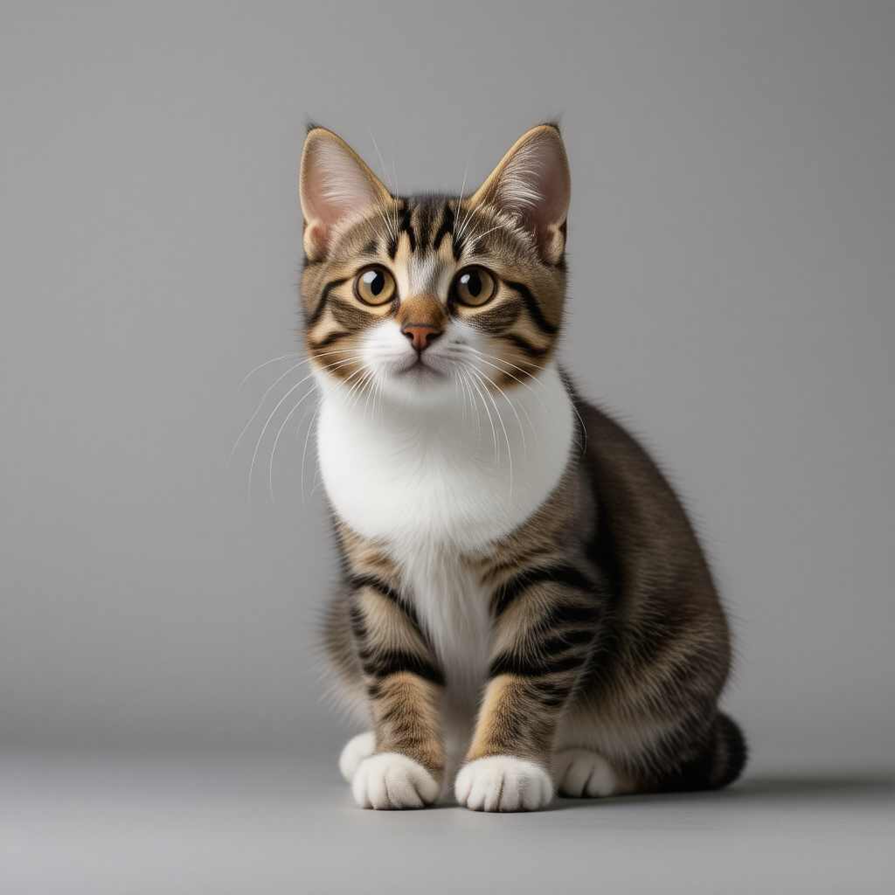

# halodiffuse

[](https://www.amd.com/)
[](https://www.amd.com/)
[](https://www.rust-lang.org/)
[](https://www.vulkan.org/)
[](https://www.gnu.org/licenses/agpl-3.0)
[](https://huggingface.co/stabilityai/stable-diffusion-3.5-large-turbo)

## Stable Diffusion 3.5 Large Turbo for Strix Halo

A minimal, ultra-fast Vulkan/Rust inference engine purpose-built for **AMD Strix Halo** (`Ryzen AI Max+ 395`). Features a persistent background daemon that keeps weights resident in unified memory for true **5.3s** per-image generation without Python or ROCm runtime overhead.

### Usage

```bash
# Start the background daemon (loads all 5 weight files into memory once)
halodiffuse start

# Generate images (instant dispatch against warm weights)
halodiffuse --prompt "cat" --path ~/Pictures/cat.png --seed 42

# Stop the daemon and free memory
halodiffuse stop
```



## Installation

**Requirements:**
* **Hardware:** AMD Ryzen AI Max+ 395 (64GB+ unified memory)
* **OS:** Linux (with Vulkan 1.3 support)
* **Model Access:** Accepting the [Stability AI Community License](https://huggingface.co/stabilityai/stable-diffusion-3.5-large-turbo) on Hugging Face

```bash
# 1. Install the binary (from Releases or `cargo build --release`)
chmod +x halodiffuse
sudo mv halodiffuse /usr/local/bin/

# 2. Download and prepare weights
pip install torch safetensors huggingface_hub
hf auth login
python install.py # Optional parameters to force or use existing weights (see --help)
```

## Benchmarks

**Configuration:** Stable Diffusion 3.5 Large Turbo | `FP16` | `1024x1024` | `Batch Size 1` (4 steps)

> **Methodology:** All engines were benchmarked with models **pre-loaded and warm in memory** to measure true per-image generation time. Using `halodiffuse start` keeps all weights loaded between prompts, making `5.3 s` the actual wall-clock wait per image.

| Engine                    | Backend      | Precision   | End-to-End (Warm) | Runtime                   |
| :------------------------ | :----------- | :---------- | :---------------- | :------------------------ |
| **`halodiffuse`**         | **`Vulkan`** | **`FP16`**  | **`5.3 s`**       | **`~15.6 MB binary`**     |
| **ComfyUI**               | ROCm         | BF16 / FP16 | ~11.8 – 14.5 s    | ~18 GB Python + ROCm venv |
| **stable-diffusion.cpp**  | Vulkan       | FP16        | ~13.5 – 16.2 s    | ~50 MB binary             |
| **HuggingFace Diffusers** | ROCm         | BF16 / FP16 | ~18.4 s+          | ~18 GB Python + ROCm venv |

## Code License

halodiffuse  
Copyright (C) 2026 Thopuri Omkar Eeswar

This program is free software: you can redistribute it and/or modify
it under the terms of the GNU Affero General Public License as published by
the Free Software Foundation, version 3 of the License.

This program is distributed in the hope that it will be useful,
but WITHOUT ANY WARRANTY; without even the implied warranty of
MERCHANTABILITY or FITNESS FOR A PARTICULAR PURPOSE. See the
GNU Affero General Public License for more details.

You should have received a copy of the GNU Affero General Public License
along with this program. If not, see <https://www.gnu.org/licenses/>.

## Model License

The Stable Diffusion 3.5 Large Turbo model weights are governed by the [Stability AI Community License Agreement](https://huggingface.co/stabilityai/stable-diffusion-3.5-large-turbo/blob/main/LICENSE.md). `Powered by Stability AI`
